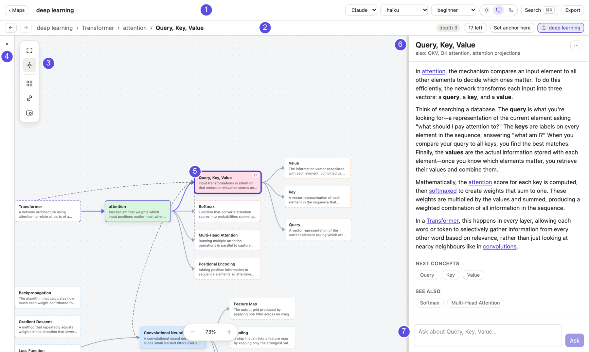

# Mindmapper user guide

Setup, a tour of the screen and everything you can do. Back to the [README](README.md).

## Setup and requirements

- **macOS or Linux** (Windows is untested)
- **Node.js 22 or newer** (`node -v` to check)
- At least one of these, **signed in with your subscription**:
  - **Claude Code** with a Claude plan (Pro or Max). Sign in by running `claude` and typing `/login`.
  - **Codex CLI** with ChatGPT (Plus, Pro or Team). Sign in by running `codex login`.

Mindmapper never asks for an API key. If a CLI is logged in with an API key instead of a plan, Mindmapper refuses to use it, so you cannot be billed per token by accident (see [Troubleshooting](#troubleshooting)).

Each time you press **Explain** or send a question, one request goes through your own CLI and counts against your plan's normal usage limits.

## Setup

```bash
git clone <this repository>
cd mindmapper
npm install
npm run dev
```

Then open **http://localhost:5173** in your browser.

The home screen shows a status chip for each provider. Claude and/or ChatGPT should say **ready**. If one says *not installed* or *not logged in*, click it to see what to run.

To run it as a single server instead (no hot reloading):

```bash
npm run build
npm start        # then open http://127.0.0.1:8787
```

### Where your data lives

Maps are saved as JSON files in `./data/maps/`. Back that folder up if your maps matter. To keep them elsewhere:

```bash
MINDMAPPER_DATA_DIR=~/Documents/mindmapper-data npm run dev
```

### Settings (environment variables)

| Variable | Default | What it does |
|---|---|---|
| `MINDMAPPER_DATA_DIR` | `./data` | Where maps and exports are stored |
| `MINDMAPPER_PORT` | `8787` | Server port |
| `MINDMAPPER_TIMEOUT_MS` | `90000` | Stop a single generation after this long |
| `MINDMAPPER_MAX_CONCURRENCY` | `2` | Generations running at the same time |
| `MINDMAPPER_CLAUDE_BIN` / `MINDMAPPER_CODEX_BIN` | `claude` / `codex` | Path to a CLI that is not on your `PATH` |

## Using Mindmapper

### Start a map

1. On the home screen, type a topic (for example *Deep learning*).
2. Pick your **level**: beginner, intermediate or advanced. This changes how explanations are written.
3. Optionally add a **goal** ("prepare for an exam"). It is passed along with every request.
4. Press **Start mapping**. The overview streams in on the right, and a few starter cards appear on the board.

### The screen



1. **Top bar.** Provider, model and level, the theme switch, search and export.
2. **Where you are.** The breadcrumb, the depth counter, **N left**, the pin that sets the anchor here, and the anchor button that jumps back to it.
3. **Board tools.** Fit the whole map, centre on the selected card, tidy up, show all cross-links, show a minimap.
4. **Trail.** The cards you visited, in order. Open it with the arrow; it is collapsed here.
5. **The board.** Cards and their connectors. Pan by dragging the background, zoom with the wheel or the `−` `+` buttons.
6. **Card panel.** The selected card's explanation, next concepts, **See also** and saved questions. Drag its left edge to resize it.
7. **Question box.** Ask anything about the selected card.

- **Board (left):** the map. Pan by dragging the background, zoom with the wheel or the `−` `+` buttons.
- **Panel (right):** the selected card. Drag its left edge to resize it.
- **Tools (floating, far left of the board):** fit the whole map, centre on the selected card, tidy up the layout, show all cross-links, show a minimap.
- **Trail (column left of the board):** the cards you visited, in order. Collapse it with `«`.

On a narrow window (under about 860 px) the panel moves below the board and the trail collapses to give the board room.

### Reading a card

| What you see | What it means |
|---|---|
| Dashed outline | Not explained yet. Press **Explain** (or double-click the card). |
| Filled colour card | Explained. The colour changes with depth, so each level reads at a glance. |
| Pulsing card, "Writing…" | Being written now. **Stop** (or `Esc`) cancels it. |
| Orange card with ⚠ | The last attempt failed. The panel shows the reason and **Try again**. |
| ⚓ badge | The anchor card. |
| `2?` badge | The card has 2 questions saved on it. |
| `+4` badge | A collapsed card hiding 4 cards. |
| Your own colour | Cards are coloured by depth. Use **Colour…** in the card's menu to pick one yourself, for example to mark what you have understood. |
| Bright ring | The selected card. Connectors along your path to it are highlighted. |

### Going deeper

- **Click a solid link** in an explanation to jump to that card.
- **Click a dotted link** to create that concept under the current card and have it explained.
- **Select any words** in an explanation or answer. A small bar offers **Explain this** (makes the selection a card) and **Ask about this** (quotes it in your question).
- **Open a suggested concept** from **Next concepts** at the bottom of a card.
- **Add the rest.** Concepts a card mentions but has no card for appear under **Mentioned, no card yet**. Click one to add and explain it, or press **Add all N** to add them all as cards without asking the AI anything.
- **Ask a question** in the box at the bottom of the panel (`Enter` sends, `Shift+Enter` adds a line). The answer is saved on the card. If it names distinct kinds, parts or steps, they appear as new cards under it.

If the same concept is already on the board, Mindmapper links to the existing card instead of making a copy.

### Never lose your place

Learning gets deep fast, so four tools are always on screen:

- **Breadcrumb**: where this card sits in the subject, from the root down. Click any part to jump there.
- **Trail**: the cards you visited, in order. Click one to return to it.
- **Back and Forward** (`Alt+←` and `Alt+→`): step through the trail like a browser.
- **Anchor**: the card you consider "home". It starts as the root. Press **Set anchor here** on any card, and the **⚓** button in the top bar (or the `A` key) brings you straight back. The **depth** counter turns amber at depth 5, a hint that you are well down a rabbit hole.

**Search** (`Cmd/Ctrl+K`) finds a card by name or alternative name.

### What's left

The **N left** button in the top bar (or **What's left…** in the board's right-click menu) lists every card you have not explained yet, grouped by the card it hangs under, with a progress bar. Press **Open** to go to a card, or **Explain** to write it right there. Tick **Only under “…”** to see just the selected branch. Cards whose last attempt failed show **Try again**. When nothing is left the button reads **✓ all opened**.

### Arranging the board

- **Drag a card** anywhere. Its position is saved. Cards you have not moved follow their parent when it moves.
- **Tidy up** returns every card to the automatic layout.
- **Collapse a branch** to hide it (its card shows how many are hidden).
- **Rename** a card; the old name keeps working as a link.
- **Merge** two cards that mean the same thing; their questions and children are combined.
- **Delete** a card and everything below it (you are asked first). Both delete and merge can be undone: press **Undo** on the message that appears, or `Cmd/Ctrl+Z`. Undo puts back exactly what the action changed, including questions, cross-links and positions. It is refused if one of those cards has changed since, or if a card with the same name now exists. Undo is remembered only until the server restarts.
- **Colour** a card with **Colour…** in its menu; **Automatic** returns it to its depth colour.
- **Export** (top bar) writes one Markdown file per card to `./data/exports/<map name>/`, with `[[wikilinks]]` intact, so the folder opens as an Obsidian vault. Exporting again replaces that folder. A folder you made yourself with the same name is never touched; a numbered one (`<map name> (2)`) is used instead.

### Right-click menu

Right-click a card (or press `Shift+F10`) for everything you can do to it: Explain or Regenerate, Ask a question, **Add child concept** (creates a card by name with no AI request), go to parent or first child, set as anchor, release position, **Colour…**, collapse, copy its link or explanation, rename, merge and delete. Right-click empty board space for fit, what's left, go to anchor, tidy up and cross-links.

### Switching AI or level

Use the dropdowns in the top bar to change **provider** (Claude or ChatGPT), **model** (Claude only) and **level** at any time, even partway through a map. Each request is rebuilt from the map, so switching never loses context.

| | Claude | ChatGPT (Codex) |
|---|---|---|
| Text appears as it is written | Yes | No, the whole answer arrives at once |
| Typical time for one card | about 8 to 10 seconds | about 15 seconds |

### Themes

The three buttons in the top bar choose **Light**, **System** (follows your computer) or **Dark**. Your choice is remembered in this browser.

<details>
<summary><b>Keyboard shortcuts</b></summary>

| Keys | Action |
|---|---|
| `Cmd/Ctrl+K` | Search |
| `Cmd/Ctrl+Z` | Undo the last delete or merge |
| `Alt+←` / `Alt+→` | Back / Forward |
| `Enter` | Explain the selected card (when the board has focus) |
| `/` | Jump to the question box |
| `A` | Go to the anchor |
| Arrow keys | Move selection: `←` parent, `→` first child, `↑` `↓` siblings |
| `Shift+F10` or menu key | Open the selected card's menu |
| `Esc` | Close a menu or dialog; otherwise stop a running generation |

</details>

### Tips

- Start broad, then open only the cards you care about. Unopened cards cost nothing.
- Set the anchor before you dive in. It is the cheapest way to find your way back.
- Phrase questions as "what are the kinds of…" or "what are the steps of…" to grow a branch.
- Use **Add child concept** when you already know what you want a card to be called.


---


---

## Troubleshooting

| Problem | What to do |
|---|---|
| A provider chip says **not installed** | Install that CLI, then click **Check again**. |
| **not logged in** | Run `claude` and type `/login`, or run `codex login`, then click **Check again**. |
| **API-key login (refused)** | Mindmapper only uses subscription logins so it never bills per token. Log out of the CLI and sign in with your plan. |
| A card shows a usage or rate-limit message | That is your provider's own message. Wait for your limit to reset, or switch provider in the top bar. |
| "This took too long and was stopped" | Press **Try again**. Raise `MINDMAPPER_TIMEOUT_MS` if it keeps happening. |
| "Could not reach the Mindmapper server" | The server is not running. Start `npm run dev` again. |
| `EADDRINUSE` on start | Another program uses port 8787. Set `MINDMAPPER_PORT` to something else. |
| "Could not copy" appears | Your browser blocked clipboard access. Allow it for this page. |
| A map shows as **Unreadable** | Its file in `data/maps/` is damaged. Mindmapper leaves it untouched so you can repair or recover it. |

## Privacy and safety

- The server listens on `127.0.0.1` only and rejects requests from other sites or hosts.
- Nothing is sent anywhere except the prompt that goes through your own Claude or Codex CLI. Images in an AI answer are never loaded, and the page the server serves carries a policy that blocks requests to other sites.
- Mindmapper never reads your CLI credentials and never uses an API key.
- It is built for one person on one computer. It is not designed to be put on a network or shared with other people.

