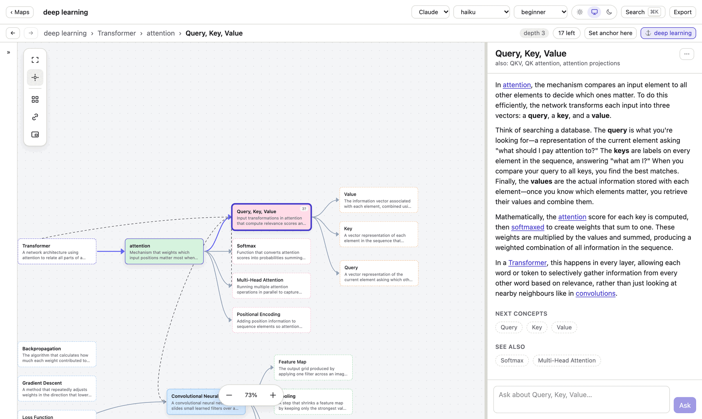

<div align="center">

<picture>
  <source media="(prefers-color-scheme: dark)" srcset="assets/logo-dark.png">
  
</picture>

### Go down the rabbit hole without losing your way back.

Learn any topic with AI on a map you can walk around, instead of a chat that scrolls away.


[Quick start](#quick-start) · [Features](#features) · [User guide](GUIDE.md) · [FAQ](#faq)

<br>

<picture>
  <source media="(prefers-color-scheme: dark)" srcset="assets/screenshot-dark.png">
  
</picture>

</div>

<br>

## Why

Ask an AI about deep learning and the answer mentions CNNs. Ask about CNNs and you get layers, then neurons, then channels. Five questions later you have lost where you started, and so has the chat.

**A chat is one long line. Learning a subject is a graph.** Mindmapper puts each explanation on a board of cards. Every term is a link, a concept that appears twice stays one card, and you can always see how you got here and get back.

## Quick start

You need **Node.js 22+** and one signed-in CLI: **Claude Code** (`claude`, then `/login`) or **Codex** (`codex login`).

```bash
git clone <this repository>
cd mindmapper
npm install
npm run dev
```

Open **http://localhost:5173**, type a topic and press **Start mapping**. Settings, the screen tour, shortcuts and troubleshooting are in the **[user guide](GUIDE.md)**.

## Features

- **Never lose your way.** Breadcrumb, trail, Back/Forward, search, an **anchor** that takes you home in one click, and an **N left** counter for cards you have not opened.
- **Every term is a link.** Click one to jump to an existing card, or to create a new one. One card per concept, however many places mention it.
- **Ask on any card.** Answers are saved there, and the kinds or parts they name become new cards.
- **Yours to arrange.** Drag, colour, collapse, rename, merge and delete with **Undo**. Light and dark themes. Export to Markdown for Obsidian.
- **No API key, no extra cost.** It drives the `claude` and `codex` CLIs you are already signed in to, and refuses an API-key login so you are never billed per token. Nothing is generated until you press **Explain** or **Ask**.
- **Local-first.** The server listens on your machine only, and maps are plain JSON files in `./data/maps/`.

## FAQ

**Does it cost anything?** The app is free. Each explanation or question is one request through your own Claude or ChatGPT plan, against its normal usage limits.

## For developers

```bash
npm test             # unit, integration and component tests (no real AI calls)
npm run typecheck
npm run lint
npx playwright install chromium   # once, for the browser tests
npm run test:e2e     # rebuilds, then drives the app in a real browser with a fake AI
# The same checks run in CI (.github/workflows/ci.yml) on every push and pull request.

# These spend a little of your plan quota. Run them by hand.
npm run smoke -- claude [--model haiku]            # one real call, prints timings
npm run smoke -- codex
npm run smoke -- claude --ask "what are the kinds of padding"
npm run smoke -- claude --expand "Sensor Size"     # an explanation of a concept with a set of kinds
npm run test:real    # drives the browser against real Claude (3 calls)
```

Rules for contributors, including the "no API keys" rule, are in [CLAUDE.md](CLAUDE.md). Design notes start at [docs/PRD.md](docs/PRD.md).

## Limits

- Claude and ChatGPT (Codex) are supported. Gemini is not: its command-line tool no longer serves individual subscriptions.
- An answer adds at most 5 new cards. Further concepts it names stay as dotted links, and **Add all** turns the rest into cards.
- Explanations come from the AI's own knowledge. They can be wrong, and nothing is checked against sources.
- One person, one computer. No accounts, sync or sharing.
